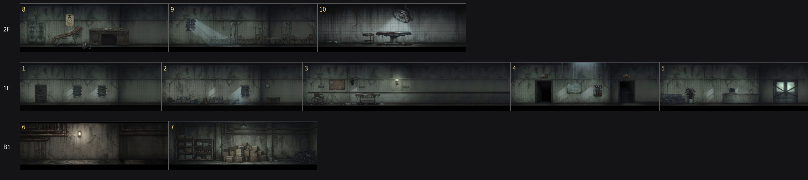
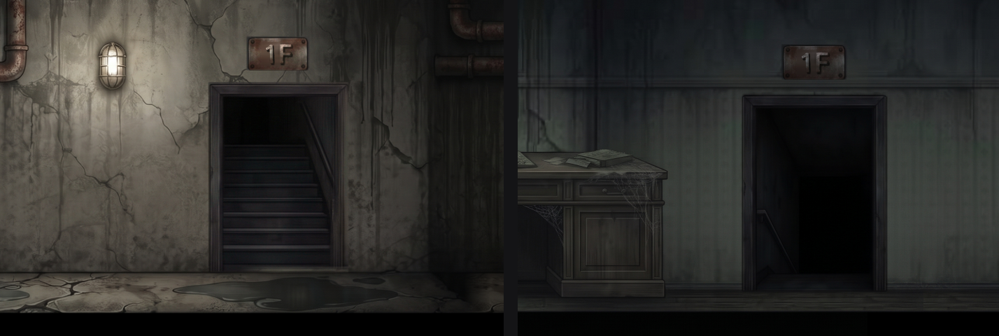
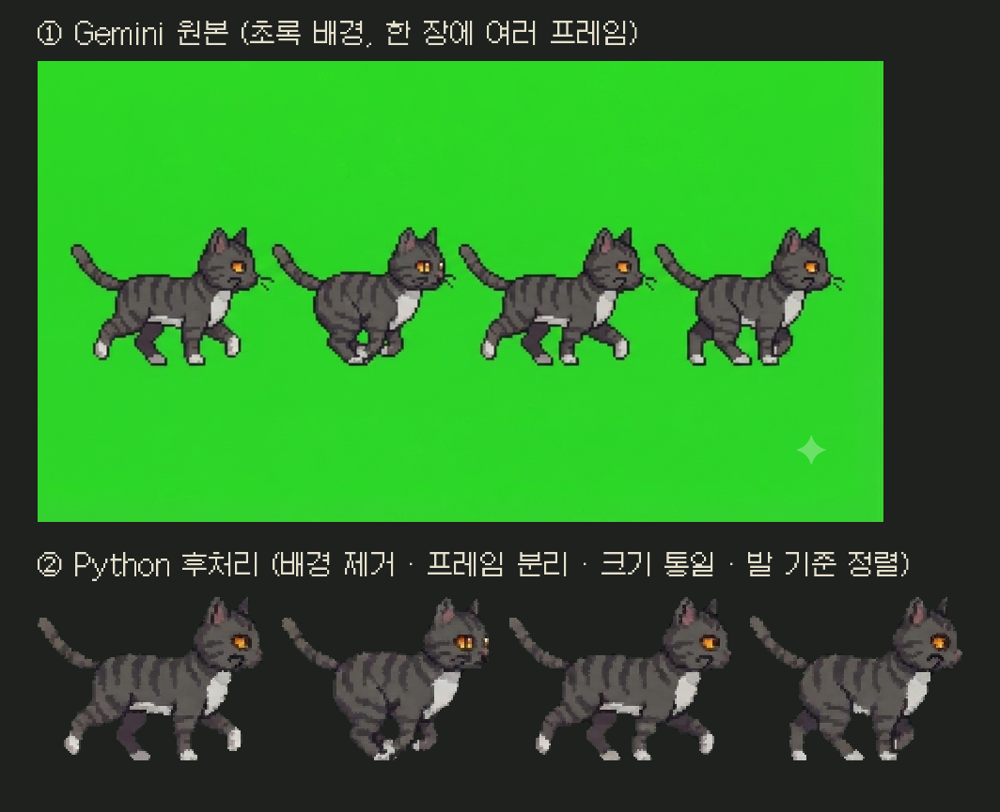
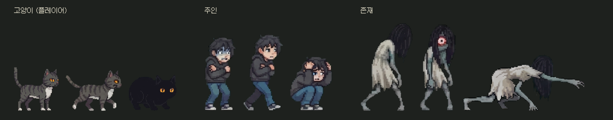
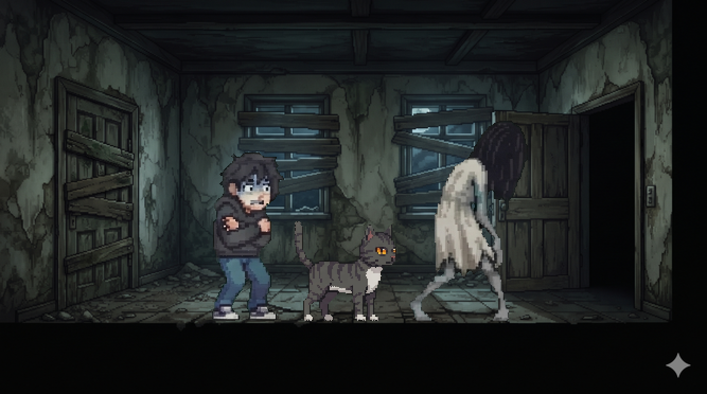
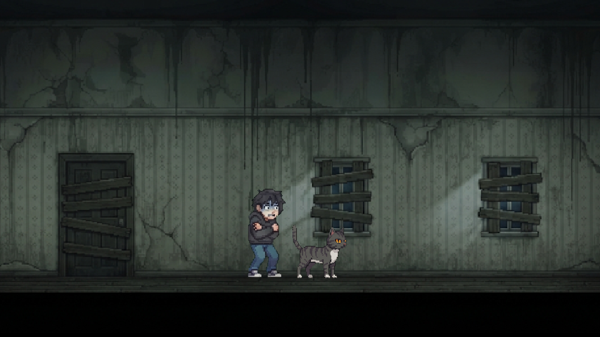

# Whisker — AI 활용 기록

> 발표(수업 5분 / 경진대회 10분)는 게임 소개보다 **AI를 활용해 게임을 만든 과정**을 중심으로 한다.
> 이 문서는 지금까지 AI를 어디에, 어떻게 썼고, 무엇이 안 됐고, 어떻게 해결했는지를 날짜순으로 정리한 기록이다.
> 작업할 때마다 아래에 이어서 추가한다.

## 1. 사용한 AI 도구

| 도구 | 역할 | 쓴 곳 |
| --- | --- | --- |
| **Gemini** (이미지 생성) | 디자인 | 고양이·주인·존재 스프라이트, 방 배경 |
| **Claude** | 프로그래밍 | Unity C# 스크립트 전체, 게임 구조 설계, 버그 원인 분석 |
| **Claude** | 이미지 후처리 | Python으로 배경 제거·프레임 분리·크기 통일·정렬, 소품 픽셀 그림 생성 |
| **Claude** | 기획·문서·번역 | 기획서, 일정, 개발 기록(README), Gemini·ElevenLabs 프롬프트, 게임 문구 영어 번역, itch.io 페이지 문구 |
| **ElevenLabs** (효과음 생성) | 사운드 | 효과음 20여 개 + 배경음악 (출처 표기) |

API 연동 없이, 대화형으로 결과물을 받아 직접 검토하고 수정하는 방식으로 사용했다.

## 2. 전체 흐름 (AI가 들어간 지점)

```
[기획] Claude와 대화로 콘셉트·기능·일정 정리
   ↓
[프롬프트] Claude가 Gemini용 영어 프롬프트 작성 (한국어 번역 함께)
   ↓
[생성] Gemini로 이미지 생성 → 마음에 드는 결과 선택
   ↓
[후처리] Claude가 작성한 Python으로 배경 제거·분리·크기 통일·정렬
   ↓
[미리보기] 캐릭터를 실제 게임 화면 비율로 합성한 목업으로 어울림 확인
   ↓
[적용] Claude가 C# 스크립트 작성 + Unity 설정값(.meta) 직접 수정
   ↓
[테스트] 직접 플레이 → 문제를 설명하면 Claude가 원인 분석 → 수정
```

## 3. 날짜별 기록

### 9월 ~ 10월 초 — 기획
- Claude와 대화하며 주제 선정: "고양이만 볼 수 있는 존재를 피해 주인을 데리고 탈출하는 2D 공포 게임"
- 요구사항, 기능 목록, 주차별 개발 일정, 기획서 정리
- 생성형 AI 활용 범위를 **프로그래밍 / 디자인 / 문서작성** 세 분야로 결정

### 10/10 — 고양이 에셋 (Gemini) + 첫 후처리 (Claude Python)

**생성**
- 기준 캐릭터 → 감정 대기 2종 → 모션 8종(걷기, 겁먹은 채 걷기, 점프, 기어가기, 벽타기, 숨기, 겁먹음, 울기)
- 초록(#00FF00) 단색 배경, 오른쪽 아래는 비워두기(워터마크 자리)

**안 됐던 것 → 해결**
| 문제 | 해결 |
| --- | --- |
| 여러 모션을 한 번에 요청하면 캐릭터 일관성이 깨짐 | **모션 하나당 요청 한 번** |
| "걷기"처럼 동작 이름만 쓰면 원하는 자세가 안 나옴 | **프레임별 자세를 구체적으로** 지시 ("1번: 왼쪽 앞발을 앞으로…") |
| 한 장 안에서 일부 프레임만 고쳐달라는 요청은 거의 반영 안 됨 | 좌우 반전·프레임 선택 등 **후처리로 해결** |

**Python 후처리 (Claude 작성)**
| 단계 | 방법 |
| --- | --- |
| 배경 제거 | 픽셀마다 "초록 정도 = G − max(R, B)"를 계산해 기준 이상이면 투명 처리 |
| 워터마크 제거 | 오른쪽 아래 영역을 항상 비움 |
| 프레임 자동 분리 | 세로 열마다 캐릭터 픽셀 수를 세서, 비어 있는 열을 기준으로 자름. 붙어 있으면 가장 얇은 지점에서 자름 |
| 크기 통일 | 모션마다 Gemini가 그린 크기가 달라서, 기준 캐릭터 대비 비율을 구해 맞춤 |
| 발 기준 정렬 | 모든 프레임을 발바닥(아래 가운데) 기준으로 정렬 → 애니메이션이 튀지 않음 |
| 초록 테두리 제거 | 경계를 1픽셀 깎고, 초록이 빨강·파랑보다 진하지 않게 보정 (despill) |

| 후처리 전 문제 | 후처리 후 |
| --- | --- |
| 48px로 줄였더니 너무 흐림 | 96px로 다시 처리 |
| 테두리에 초록빛이 남음 | 경계 깎기 + 초록 보정으로 해결 |

### 10/11 — 화질 개선 (Claude Python)
- 울기 그림이 흐리게 보이는 문제: 원본 해상도가 낮은 상태에서 **평균으로 줄이면 경계가 뭉개짐**
- 해결: 축소할 때 칸마다 평균색 대신 **가장 많이 나온 대표색 하나를 고르는 방식**으로 전체 재처리 → 픽셀아트 경계가 또렷해짐
- 울 때 고양이가 작아지는 문제: 그림마다 Unity 설정(Pixels Per Unit)이 달랐음 → 전체 100으로 통일

### 10/12 — 주인·존재 에셋 (Gemini)

**주인**
- 콘셉트: 항상 겁먹은 사람 (떨림은 그림이 아니라 코드로)
- 한 장에 대기·걷기·숨기를 함께 요청 → 같은 사람으로 일관되게 나옴
- 걷기 5장 중 색이 틀린 1장, 중복 1장을 빼고 **2 → 1 → 3 → 1** 순서로 4프레임 구성

**존재**
- 콘셉트 3종(그림자 인간 / 뒤틀린 여자 / 연기 가면) 생성 후 비교 → 가장 무서운 **뒤틀린 여자** 선택
| 문제 | 해결 |
| --- | --- |
| 기어오기 시트에서 같은 그림이 반복되고 다른 콘셉트가 섞임 | 콘셉트 이미지만 첨부하고 프레임별 자세를 구체적으로 지시 |
| "먼 쪽 팔다리는 더 어둡게"를 검은색으로 칠함 | 프롬프트에 검은색 금지 추가, 남은 부분은 후처리로 회색 보정 |
| 이전 결과를 첨부하면 같은 자세 순서를 그대로 따라 그림 | 쓸 만한 프레임만 골라 **1 → 2 → 4 → 2** 순서로 사용 |
| 두 시트의 존재 크기가 2배 이상 다름 | 머리카락 길이를 기준으로 크기를 맞춤 |
| 채팅에 이미지를 올리면 자동으로 축소됨 | **원본을 zip으로** 전달 |

### 10/27 ~ 11/2 — 게임 기능 (Claude 코드)
| 날짜 | 기능 | AI가 한 일 |
| --- | --- | --- |
| 10/27 | 애니메이션, 주인 떨림 | 스크립트 작성 + 스프라이트 16개의 기준점을 발밑으로 **설정 파일 직접 수정** |
| 10/28 | 존재 AI | 상태 머신 설계 (숨어 있음 → 발견 → 추격 → 덮치기 → 복귀), 고양이 시야 판정 |
| 10/29 | 게임오버·재시작 | 화면 암전 연출, 재시작. 빌드 목록에 씬이 빠진 원인 발견 |
| 10/31 | 한글 표시 | WebGL에서 한글이 깨지는 원인(기본 폰트에 한글 없음) 찾고 무료 픽셀 폰트(Galmuri, OFL) 추천 |
| 11/1 | 숨기, 주인 이동 방식 변경 | 벽·낭떠러지 감지, 혼자/함께 숨기 |
| 11/1 | 숨을 때 고양이가 커 보임 | **그림을 나란히 놓고 비교해 숨기 그림이 약 1.25배 크게 그려진 것을 측정** → 그 그림만 크기 설정을 125로 바꿔 80%로 맞춤 |

### 11/3 — 배경 (Gemini 시행착오 + Claude 목업 검토)

| 시도 | 결과 | 판단 |
| --- | --- | --- |
| 1. 방 하나를 정면에서 본 그림 | 분위기는 좋지만 양옆 벽이 비스듬함. 뒷벽의 문으로 걸어 나가면 벽을 뚫는 것처럼 보임 | 사용 안 함 |
| 2. "단면도처럼" 요청 | 원근이 그대로 남음 | 사용 안 함 |
| 3. 벽 / 바닥 / 문틀을 부품으로 따로 생성 | 벽·바닥은 평평하게 잘 나옴, 문틀만 비스듬함 | 방향 참고 |
| 4. **"건축 입면도처럼 평평한 벽" + "천장을 아주 높게, 문은 벽 높이의 1/3"** | 원근 없음, 캐릭터와 그림체·비율이 맞음 | **확정** |

- 다른 공포 게임 장면을 참고 자료로 보여주고 구도를 설명 → "원근 없는 평평한 뒷벽 + 얇은 바닥 띠" 방향 결정
- **목업 합성**: Gemini 결과를 받을 때마다 Claude가 캐릭터를 실제 게임 화면 비율로 합성해 보여줌 → Unity에 넣기 전에 "문이 너무 크다", "배경이 작아 보인다"를 미리 판단
- 후처리: 워터마크 부분 잘라내기, 캐릭터 픽셀 크기에 맞게 절반으로 축소, 바닥판 아래 검게 정리, **그림 기준점을 바닥선에 맞춰** Unity에 놓기만 하면 바닥 높이가 맞도록 설정
- 출입구 기둥은 Gemini가 원근을 계속 넣어서, **배경 색을 뽑아 Python으로 직접 그림**

### 11/4 — 구조 변경 + 2번 방 배경
- 쪽지·스토리를 빼고 순수 공포 게임으로 방향 변경
- 방 이동 (Claude 코드): 방들을 가로로 이어 붙이고, 고양이가 있는 방에 맞춰 카메라 범위가 바뀌도록 구현
- 쪽지 기능 제거 시 Claude가 파일 이름만 바꾸고 Unity 식별 번호(.meta)는 유지해서, 씬에 연결된 설정을 잃지 않고 구조를 바꿈

**2번 방 배경 (Gemini)**
| 방법 | 결과 |
| --- | --- |
| 1번 방 프롬프트 구조는 그대로, 장면 설명만 변경 (대기 의자, 상자, 책상, 고장 난 시계) + **1번 방 배경을 스타일 참고로 첨부** ("같은 그림체·벽지·색·바닥판·비율은 유지하되 새 장면을 그려줘") | 한 번에 1번 방과 벽지·색감·바닥판·천장 높이가 똑같이 나옴 |

- 배운 점: 참고 이미지를 첨부하면 스타일 일관성이 크게 좋아짐. 다만 "같은 스타일로"만 쓰면 배치까지 따라 그리므로 "새 장면을 그려줘(draw a new scene)"를 함께 써야 함
- 후처리 (Claude Python): 바닥판 윗선을 자동으로 측정 → 2번 방은 1번 방보다 바닥선이 1.5픽셀 낮게 그려져 있어 기준점을 따로 맞춤. 두 방을 이어 붙여도 바닥 높이가 일치
- 배경에 그려진 박스·책상 위치를 계산해 숨을 곳(Hide Spot)을 그 위치에 배치

### 11/5 — 열쇠·잠긴 문 + 존재 순찰 (Claude 코드·픽셀 그림)
- 기획 (Claude): "존재 1명이 맵 전체를 돌아다님, 숨을 곳 4곳, 방 가로 길이는 자유"라는 조건으로 10개 방 구성표 초안 작성 (열쇠 3개 → 잠긴 문 3개로 진행 순서를 만듦)
- 코드 (Claude): 열쇠 줍기·잠긴 문 열기, 존재에 순찰 상태 추가. 기존 코드를 읽고 충돌을 미리 찾아 함께 고침
  - 숨기 안내가 매 프레임 안내 문구를 지워서 문 안내가 안 보일 것 → 안내를 출처별로 보관하도록 변경
  - 주인은 Ground 레이어만 벽으로 인식 → 문이 스스로 Ground 레이어가 되게 함
  - 존재는 Kinematic이라 문을 그냥 통과 → "존재는 문을 뚫고 다닌다"는 설정으로 그대로 활용
- 픽셀 그림 (Claude Python): 잠긴 문과 열쇠를 직접 그림. 출입구 기둥 그림의 픽셀을 읽어 **빈 출입구 영역(46×228px)과 나무틀 색을 측정**하고, 그 크기에 맞는 나무판자 문(쇠띠·녹·자물쇠)을 생성 → 기둥과 같은 위치에 놓기만 하면 출입구에 딱 맞음
- Unity 임포트 설정(.meta)도 Claude가 직접 작성 (픽셀 크기 100, Point, 문은 발밑 기준점)

### 11/6 — 존재가 맵을 알아서 돌아다니게 (Claude 코드)
- 요청: "존재가 맵을 돌아다니고, 고양이가 안 봐도 사라지지 않고 알아서 움직이게"
- Claude가 순찰 지점을 사람이 직접 찍는 방식 대신, **이미 만들어 둔 방 범위(Room)를 읽어 목적지를 자동으로 고르는 방식**을 제안·구현 → 방을 늘려도 추가 설정 없이 존재가 새 방까지 돌아다님
- 시작 방은 이름으로 제외해 안전한 방으로 유지, "항상 보이기"는 게임 콘셉트(고양이만 볼 수 있음)와 충돌할 수 있어 켜고 끌 수 있는 옵션으로 만듦

### 11/7 — 방 10개 완성, 3개 층, 계단 (Gemini 8장 + Claude Python·코드)

**배경 생성 (Gemini)**
- 1번 방 배경을 스타일 참고로 첨부하고 장면 설명만 바꿔 7장을 한 번에 요청 → 그림체·천장 높이·바닥선이 거의 같게 나옴
- 층 나누기(1층·지하·2층)는 사용자 아이디어, Claude가 "계단을 문처럼 들어가면 화면 전환" 방식을 제안 (비스듬한 계단을 주인·존재 AI가 오르내리게 만드는 부담을 피함)

| 문제 | 원인 | 해결 |
| --- | --- | --- |
| 4·6번 오른쪽 아래 바닥이 비어 있음 | 프롬프트의 "오른쪽 아래 비워두기(워터마크 자리)"를 바닥까지 비우라는 뜻으로 해석 | Python으로 왼쪽 바닥을 복사해 메움 (경계는 섞어서, 어두운 벽에는 밝기 낮춰서) |
| 8번 가구가 실제의 2~3배 | Gemini는 벽 높이에 맞춰 가구를 크게 그림 | Claude가 주인 키(170cm = 1.55칸)로 가구 크기를 측정 → "책상 높이는 바닥~천장의 1/7"처럼 **비율로 크기를 지정** + 크기가 맞는 2번 방을 참고로 첨부해 다시 생성 |
| 가구만 줄이기 시도 (Python) | 가구를 줄이면 빈 벽을 새로 채워야 함 | 다른 벽을 이어 붙여 채웠지만 네모 자국이 남아 포기 → 다시 생성하는 쪽이 낫다는 판단 |

**후처리로 보완한 부분 (발표 후보)**
- **배경 늘리기**: 3번 복도를 17.9칸 → 25칸으로. 빈 벽 중 양끝이 가장 비슷한 구간을 찾아 두 번 이어 붙이고, 밝기 흐름을 맞추고 60px씩 겹쳐 섞음 → 이음매가 거의 안 보임
- **다른 그림에서 부품 옮기기**: 지하·2층에 계단 입구가 없어서, 4번 계단실 그림의 입구를 잘라 붙임 (주변 벽 밝기로 색 맞춤, 지하는 바닥선에 맞게 높이 조정)
- **글자 만들기**: 원래 그림에 없는 "1F" 표지판을 "2F" 판의 "2"를 지우고 "B1" 판의 "1"을 옮겨 만듦
- → Gemini에 다시 수정을 맡기면 다른 부분까지 바뀔 수 있는데, 후처리는 **원래 그림을 그대로 유지**하면서 필요한 부분만 더함
- **발 위치 맞추기**: 방마다 바닥판 윗선과 검은 부분 시작 줄을 자동으로 재서, 사용자가 자연스럽다고 한 2층 방의 비율(56%)을 모든 방에 적용
- **계단 철문**: 출입구 안쪽 크기(168×262px)를 측정해 Python으로 그림. 열리는 동작을 위해 문과 자물쇠를 두 장으로 나눔

**코드 (Claude)**
- 계단: 화면 전환, 주인 동행, 잠긴 철문 여는 동작(덜컹 → 자물쇠 낙하 → 가로 폭을 코사인으로 줄여 문이 도는 것처럼)
- 존재 길 찾기: 목적지가 다른 층이면 그 층으로 가는 계단을 골라 이동
- **에디터 자동 배치 도구**: 방 8개·계단·열쇠·숨을 곳을 사람이 하나씩 놓는 대신 메뉴 한 번으로 배치 → 위치를 고칠 때도 숫자만 바꾸고 다시 실행
- 렉 원인 분석: 에디터 Console 로그가 쌓여 끊김 → 로그 호출을 컴파일 단계에서 빼는 방식(`Conditional`)으로 해결

층별 맵 (계단 입구가 위아래로 겹치도록 배치)



계단 입구 합성 (왼쪽: 지하 6번, 오른쪽: 2층 8번 첫 버전)



**실수와 배운 점**
- Claude가 일정을 맞추려고 임시 배경(기존 그림을 자르고 뒤집어 만든 7장)을 묻지 않고 만듦 → 사용자가 원치 않아 되돌림. 결과물의 방향이 바뀌는 일은 먼저 물어봐야 함

### 11/8 — 퍼즐 진행 확장, 이벤트, 효과음 (Claude 코드·Python + Gemini + ElevenLabs)

**기획 (사용자 + Claude)**
- "플레이 시간이 짧다"는 문제에 사용자가 8단계 진행 구조를 직접 짬 (두꺼비집→시계의 퓨즈→전원 이벤트→침대 단서→금고→열쇠 조각 조합→추격)
- Claude는 구조를 코드로 옮기면서 빈틈을 짚음: "8번 창고"로 쓴 곳이 실제 상자 더미가 있는 7번인지 확인, 상태 UI 아이디어 여러 개 중 사용자가 **주인 공포도**를 고름 → "주인은 존재를 못 본다"는 설정에 맞게 고양이와의 거리·어두운 방으로만 오르게 함

**코드 (Claude)**
- 물건마다 스크립트를 따로 만들지 않고 **조사 물건 하나(`Interactable`)에 조건·보상·동작 칸을 두는 방식**으로 설계 → 두꺼비집·시계·침대·금고·수술대를 값만 바꿔 만듦. 이후 "퓨즈도 시간이 걸리게" 같은 요청은 칸 하나(Use Gauge)를 켜는 것으로 해결
- 조작 막기를 한곳(`GameInput`)에 모음: 팝업·연출·계단 이동·게임 끝을 모든 스크립트가 같은 기준으로 확인. 팝업을 닫는 키가 다른 곳에서 한 번 더 처리되지 않게 닫힌 프레임을 기억
- 테스트 중 발견한 문제를 설명하면 원인을 찾아 고침: 주인이 의자에 걸려 멈춤 → 주인은 Ground 레이어를 벽으로 보는데 의자도 Ground(고양이가 올라서려면 필요) → 충돌은 무시하고 벽 감지에서도 제외

**이미지 (Claude Python + Gemini)**
- 2번 방 배경에서 시계 밑 책상을 오른쪽으로 옮김: 벽지 무늬 간격(약 25.6px)을 재서 무늬가 맞는 거리(205px)만큼 옮기고, 처음 붙인 결과에 밝기 경계가 보여 **OpenCV seamlessClone(포아송 합성)**으로 다시 섞음
- 소품(두꺼비집·금고·의자)과 아이템 아이콘 6개를 픽셀 그림으로 직접 그림
- 침대 1인칭 그림: Gemini 한 장 → 워터마크를 주변 색으로 메우고(inpaint) 픽셀 결을 다시 입힘 → 이불 끝에 꼬리표(색 띠 + 5×7 픽셀 숫자)를 그려 넣고 솔기 방향에 맞게 기울이고 장면 밝기에 맞게 어둡게 → **한 장으로 침대 4개의 단서 그림**을 만듦
- Gemini에 침대마다 다시 그려 달라고 하면 침대 모양이 매번 달라지지만, 후처리는 같은 그림에 단서만 바꿔서 일관성 유지

**효과음 (ElevenLabs + Claude Python)**
| 문제 | 해결 |
| --- | --- |
| Pixabay 다운로드가 결제를 요구 | AI 생성으로 결정. Claude가 소리별 영어 프롬프트와 길이·반복·프롬프트 반영도 설정을 표로 정리 |
| 처음 들어간 사이트가 ElevenLabs가 아니라 다른 AI 사이트(Dreamina) | 스크린샷을 보고 판별 → ElevenLabs 주소와 화면 버튼별 설정을 안내 |
| 심장 소리는 코드가 간격을 바꿔 반복 재생 | AI 설정에서 반복을 끄고 한 박자만 생성, 파형을 봐서 첫 박동만 잘라냄 |
| 반복할 작업 소리가 너무 작고 mp3라 이음매에서 끊김 | 크기를 키우고 wav로 바꾼 뒤 끝과 처음을 0.12초 겹쳐 섞음 |
| 소리마다 앞쪽에 빈 구간 | 소리가 시작되는 지점을 자동으로 찾아 자르고 끝을 부드럽게 줄임 |

**배운 점**
- AI 도구는 사이트마다 설정 이름이 다름 (길이·반복·프롬프트 반영도·프롬프트 자동 보강) → 프롬프트와 설정을 소리별로 한 묶음으로 정리해야 헷갈리지 않음
- 무료 AI 생성물도 라이선스 조건이 있음 (ElevenLabs 무료 플랜: 상업 라이선스 없음, 출처 표기) → README 에셋 출처에 기록

### 11/9 — 타이틀·설정·언어, 고양이 시야, 존재 대개편, 사운드 전체, 웹 배포 (Claude 코드·Python + ElevenLabs)

**기획·테스트 (사용자 + Claude)**
- 사용자가 직접 끝까지 플레이하며 느낀 점을 짧게 말하면 (예: "존재가 너무 갑자기 튀어나와", "쫓아오다 화면 밖에서 놓쳐", "지하에서 갑자기 나오면 숨을 수가 없어") Claude가 원인을 수치·규칙으로 바꿔 고침 → 하루 동안 이런 피드백을 30번 넘게 반복
- 사용자가 방향을 되돌린 결정도 많음: 계속 따라오는 주인 → 너무 쉬워서 원래대로, 무작위 깜짝 등장 → 정해진 자리 연출로, 쫓기다 작업을 시작하면 존재가 사라짐 → 사라지면 안 됨으로. **AI가 제안·구현하고 사람이 재미를 판단**하는 구조
- 깜짝 등장 연출(뒷모습으로 서 있다가 다가가면 웃으며 사라짐)과 그 자리에 퓨즈 위치 쪽지를 두는 아이디어는 사용자 기획, Claude는 고정 위치·빛·조건으로 구현

**코드 (Claude)**
- 존재 AI에 "방 규칙"을 세 단계로 나눔: 절대 안 들어오는 방 / 갑자기 나타나지 않지만 쫓아올 수 있는 방 / 연출만 있는 방(지하) → 사용자의 말("2번 방은 갑자기 나오진 않지만 따라올 수는 있게")을 그대로 칸 하나로 옮김
- 쫓는 속도를 거리에 따라 바꿈(가까우면 3, 멀어지면 최대 5.2): 뛰는 주인(3.6)은 따라잡지 못하지만 화면 밖으로 놓치지도 않게 숫자를 맞춤
- 다국어: 문구를 바꾸지 않고 "한국어 원문 → 영어 사전"으로 표시할 때만 바꾸는 방식 → 이미 있던 수십 개 스크립트를 거의 안 고치고 영어 지원. 사전에 없는 문구는 줄·띄어쓰기로 나눠 조각마다 찾음
- 번역 검수: 화면에 나오는 한국어 문구를 코드·씬·배치 메뉴에서 전부 뽑아 영어 모드 결과를 자동으로 대조 → 빠진 문구 0개 확인. 사용자가 영어를 잘 모른다고 해서 의미가 바뀔 수 있는 곳을 짚음 (간호 일지 "해가 뜨는 색" = 노랑인데 *sunrise*는 빨강으로 읽힘 → *sunshine*)
- 웹 전체 화면에서 Esc를 브라우저가 가져가는 문제: 코드로 막을 수 없다는 걸 설명하고, "전체 화면이 풀리는 순간 = Esc"로 보고 설정을 여는 우회 방법 제시

**이미지 (Claude Python)**
- 2번 방 배경에서 책상만 오려 3번 복도 소품으로: 벽지(초록빛)와 책상(갈색)의 색 차이로 배경을 지우고, 다리 사이에 비치는 2번 방 벽지는 어둡게 → 다른 방 벽 앞에서도 어색하지 않게
- 1→2번 방 닫힌 문: 출입구 기둥 그림의 어두운 칸 크기를 픽셀로 재서(96×234) 계단 철문 그림을 맞춰 줄임 → 넣기 전에 배경 위에 합성한 미리보기로 확인
- 사용자 캡처 화면에서 책상이 캐릭터 발보다 몇 픽셀 아래인지 재서 위치 보정값(0.42칸)을 계산

**사운드 (ElevenLabs + Claude Python)**
| 문제 | 해결 |
| --- | --- |
| 발소리 결과가 거의 안 들릴 만큼 작음 (최대 4%) | 걸음이 시작되는 지점을 자동으로 찾아 한 걸음씩 자르고, 크기를 맞춰 일정한 간격으로 다시 이어 반복 소리로 만듦 |
| 문 닫히는 소리의 끼익이 쾅보다 너무 작음 | 작은 소리만 키우는 압축으로 끼익을 살림 → 쾅이 나는 시점(1.67초)을 재서 문이 닫히는 연출 시간을 맞춤 |
| 웃음소리·배경음악이 다른 소리보다 작음 | 기존 소리의 평균 크기에 맞춰 키움 |
| 배경음악 반복 시 이음매 | 반복 모드로 생성 + 끝과 처음 0.06초를 겹쳐 섞음 |
| Music 화면 설정으로 안내했는데 사용자는 효과음 화면을 쓰고 있었음 | 캡처를 보고 효과음 화면의 버튼(모델·반복·길이·프롬프트 반영)에 맞춰 다시 안내 |

**배운 점**
- 플레이 테스트 피드백은 "느낌"으로 오지만, AI에게 맡기면 원인을 숫자(거리·속도·시간)와 규칙으로 바꿔 빠르게 고칠 수 있음. 다만 재미있는지는 사람이 직접 해 봐야 판단 가능
- 웹 배포는 에디터와 다르게 동작하는 부분이 있음 (전체 화면, Esc, 첫 클릭 전 소리 막힘, 압축 설정) → 빌드해서 브라우저로 직접 확인해야 함
- 생성형 AI를 쓴 결과물은 itch.io에서도 공개해야 함 (그림·소리·글·코드)

### 11/10 — itch.io 공개·표지, 플레이 테스트 설문 (Claude Python·조사)

**표지 그림 (Claude Python)**
- 새로 그리지 않고 게임에 이미 있는 그림(3번 복도 배경, 주인·고양이·존재 스프라이트)만 합성 → 게임 화면과 그림체가 같음
- 게임의 고양이 시야(어두운 맵 + 원뿔 빛)를 이미지에서 다시 계산해 적용: 고양이 눈에서 각도·거리에 따라 밝기를 줄이고, 존재는 빛 끝에 걸쳐 보이게 배치 → "고양이만 볼 수 있다"는 설정을 표지 한 장으로 보여 줌
- 첫 결과에서 존재의 손이 고양이 얼굴을 가리고, 빛 시작점이 고양이 털 위에 하얗게 번짐 → 위치와 빛 시작점을 옮겨 다시 만듦 (매번 결과 이미지를 직접 확인)
- 작게 합성한 뒤 정수 배율(1.5배, Nearest)로 키워 픽셀이 깨지지 않게 함

**배포 판단 (Claude 조사 + 사용자 결정)**
- 사용자가 Restricted 공개를 원함 → Claude가 itch.io 공식 문서를 찾아보고 Restricted는 참여자마다 Download Key와 가입이 필요하다는 점을 설명 → 설문 참여가 쉬운 Public으로 사용자가 결정
- 확실하지 않은 부분(Draft 비밀 링크로 웹 게임이 실행되는지)은 문서에 없다고 그대로 말하고 직접 확인하도록 안내

**설문 설계 (Claude + 사용자)**
- 사용자 조건: 이름만 받고 학번·학교 같은 개인정보는 빼기, 5문항 정도
- Claude는 발표에 쓸 수 있게 문항을 고름: 플레이 시간은 구간 객관식(15분 목표와 비교), 난이도·긴장감은 1~5 숫자(평균·그래프), 막힌 곳·버그는 서술형 하나로 합침. Google Form에서 이메일 수집 끄기까지 안내

**배운 점**
- 배포 플랫폼의 공개 범위 옵션은 이름만 보고 고르면 안 됨 (Restricted = 키 발급 방식) → 문서를 확인하고 참여자 입장에서 판단
- 설문은 짧을수록 응답률이 높고, 나중에 발표 자료로 쓸 형태(숫자·구간)로 받아야 정리가 쉬움

### 11/13 — 1차 사용자 테스트 분석과 피드백 반영 (Claude 분석·코드·Python + ElevenLabs)

**테스트 (사람) → 분석 (Claude)**
- 사용자가 5명의 플레이를 옆에서 지켜보며 의견을 적고, 설문 응답(4명) 엑셀과 함께 전달
- Claude가 엑셀을 읽어 평균(난이도 3.0, 긴장감 3.5)과 플레이 시간 분포를 내고, 자유 의견·관찰 메모를 "버그 / 불편 / 바람"으로 나눠 수정 목록을 만듦
- 수업 공지(고객 10명·질문 10개 이상 = 10점)를 함께 보고 1차를 버리지 않고 "1차 → 개선 → 2차" 비교 자료로 쓰자고 계획, 2차 설문 15문항 초안 작성

**원인 찾기 (Claude가 코드 전체를 읽고 판단)**
- "같이 숨었는데 들켜서 죽음(버그?)" → 실제로는 '보는 앞에서 숨으면 들킴' 규칙이었는데, 아이템 메시지만 보이게 한 설정 때문에 "들켰다" 문구가 숨겨져 있었음 → 버그가 아니라 **안내가 안 보인 문제**로 판단하고 문구를 보이게 + 잡힌 이유를 게임오버 화면에 표시
- "지하로 가면 안 쫓아옴" → 예전에 "지하에서는 갑자기 나타나지 않게" 해 달라는 요청을 "지하에서는 아예 행동하지 않게"로 넓게 구현한 것이 원인 → 나타나기만 막고 추격·찾아오기는 허용
- "위쪽 잘림·전체화면 검은 화면" → Unity 기본 웹 화면은 게임 아래에 바가 붙어서 itch.io 창(720)보다 높아짐 → 바 없는 웹 템플릿을 새로 작성
- "2번 방 박스는 새 소리가 안 남" → 씬 파일을 직접 열어 보니 배치 메뉴가 만들지 않은 옛 오브젝트였음 → 이름으로 소리를 고르는 방식으로 해결

**새로 만든 것 (Claude 코드)**
- 숨은 곳 들추기 동작(전용 그림 없이 기존 그림을 기울이고 소품을 들썩여 표현), 아이템 반짝임(별 그림과 빛을 코드로 생성), 의자 이동 범위, 추격 음악 전환, 위치·방향이 들리는 지지직 소리, 이어지는 플레이 시간

**사운드 (ElevenLabs + Claude Python)**
- 사용자가 들어 보고 "추격 음악이 크다·배경음악과 겹친다·상자 소리가 어색하다·숨는 소리가 크다"고 판단 → Claude가 크기를 dB로 재서 기존 배경음악과 맞춤(추격 음악 약 7dB, 숨는 소리 약 10dB 줄임), 반복 이음매 처리, 프롬프트를 "상자 속으로 들어감" → "상자 더미 뒤에 숨음"처럼 게임 상황에 맞게 다시 작성

**사람이 결정한 것**
- 반영할 것과 안 할 것: 귀신 종류 추가는 일정상 보류, 갑자기 나오는 공포 연출은 의도로 유지, 안내 문구 대신 소리로 길 안내
- 시계·두꺼비집 순서(두꺼비집 먼저)처럼 원래 기획 의도를 다시 확인

**배운 점**
- 테스터의 "버그 같다"는 말은 실제 버그가 아니라 **규칙이 안 보여서** 생기는 경우가 많음 → 규칙을 화면에 보여 주는 것도 수정
- 내 요청을 AI가 넓게 해석해서 구현하면 다른 곳에서 문제가 생김 → 테스트로 발견하고 요청을 더 정확히 다시 말함
- 소리 크기는 "크다/작다" 느낌 대신 숫자(dB)로 기존 소리와 맞추니 한 번에 정리됨

## 4. 발표용 정리 (후보)

**흥미로웠던 점**
1. **Gemini는 일관성과 원근 제어가 약하다.** 여러 모션을 한 번에 그리면 캐릭터가 달라지고, "평평하게"라고 해도 원근을 넣는다. → 요청을 쪼개고, "건축 입면도" 같은 다른 분야의 용어를 빌려오니 해결됐다.
2. **AI 결과물은 그대로 쓰기 어렵고, 후처리가 품질을 결정한다.** 같은 그림도 줄이는 방식(평균 vs 대표색)에 따라 선명도가 완전히 달랐다.
3. **Claude는 코드뿐 아니라 "측정"과 "미리보기"에 강했다.** 그림 크기 차이를 수치로 재고, Unity에 넣기 전에 목업으로 어울림을 확인할 수 있었다.
4. **사용자 테스트가 혼자서는 못 찾던 문제를 찾아 줬다.** 1차 테스트(5명)의 의견을 반영 18건 / 보류·아직 6건으로 나눠 하루 만에 고쳤고, 버그처럼 보인 것 중 일부는 "규칙이 화면에 안 보임"이나 "내 요청을 AI가 넓게 구현함"에서 생긴 문제였다.

**후처리로 보완된 부분 (전후 비교 자료)**
| 문제 | 후처리 전 | 후처리 후 |
| --- | --- | --- |
| 배경 | 초록 단색 + 워터마크 | 투명 배경 |
| 프레임 | 한 장에 여러 동작 | 프레임별 파일, 발 기준 정렬 |
| 테두리 | 초록빛 번짐 | 깔끔한 외곽선 |
| 선명도 | 축소하면 흐림 | 대표색 방식으로 또렷함 |
| 크기 | 모션·캐릭터마다 제각각 | 기준 비율로 통일 |
| 배경 그림 | 워터마크, 큰 해상도 | 잘라내고 캐릭터 픽셀 크기에 맞춤 |

**보관해 둔 비교 자료** (`docs/images/`)

고양이 걷기: Gemini 원본 → 후처리 결과



캐릭터 3종 (고양이·주인·존재)



배경: 첫 시도(원근 있음) → 최종(평평한 벽)



